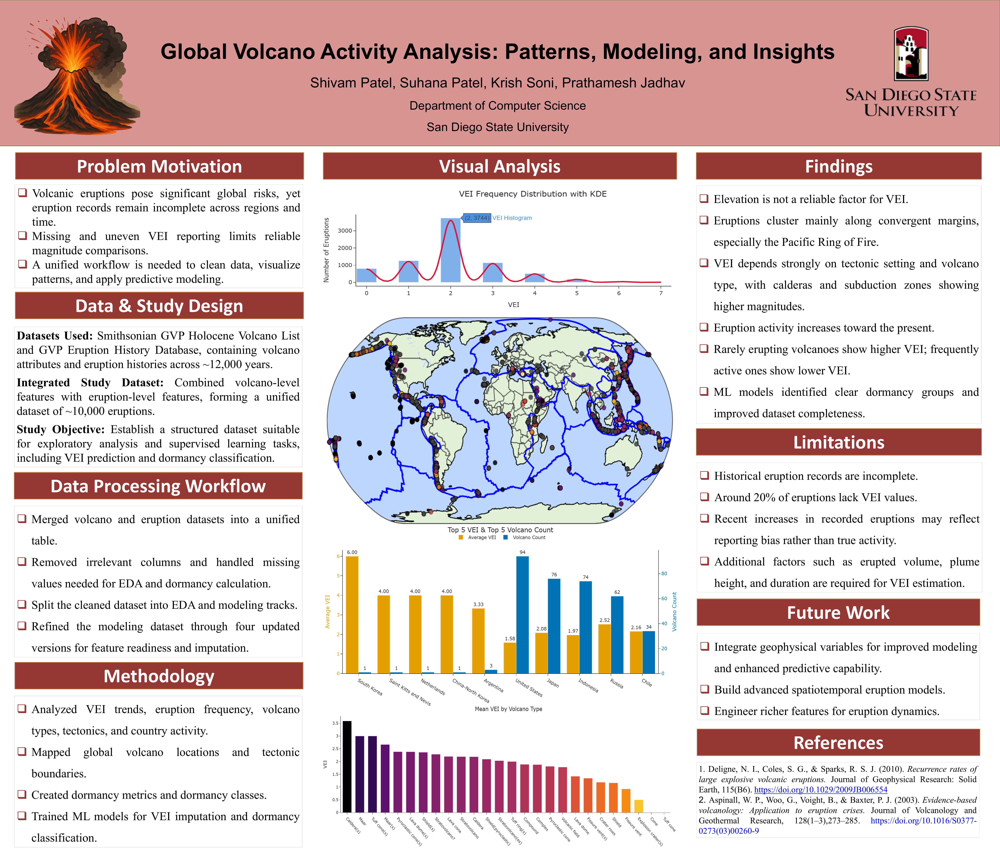

# 🌋 Global Volcano Activity Analysis and Modeling

[](https://www.python.org/)
[](https://jupyter.org/)
[](https://scikit-learn.org/)
[](https://xgboost.readthedocs.io/)
[](https://geopandas.org/)

An end-to-end data science and machine learning project analyzing global volcanic activity, eruption patterns, tectonic settings, volcano characteristics, and Volcanic Explosivity Index (VEI) values.

The project combines exploratory data analysis, geospatial visualization, feature engineering, supervised learning, class-imbalance handling, and VEI prediction using data from the Smithsonian Global Volcanism Program.

## 🖼️ Project Poster



📄 [View or download the full poster PDF](poster/DS_Poster.pdf)

## 📌 Project Highlights

- 🌍 Analyzed **9,902 eruption records** covering approximately **12,000 years** of volcanic activity.
- 🧹 Merged volcano-level attributes with eruption-history data using `Volcano Number`.
- 🗺️ Mapped global eruptions alongside tectonic plate boundaries.
- 📊 Investigated VEI patterns by tectonic setting, volcano type, elevation, country, and region.
- 🧠 Engineered geological and dormancy-related features for machine learning.
- ⚖️ Used **SMOTE** to address imbalanced VEI classes.
- 🚀 Trained and tuned an **XGBoost** model for 3-class VEI classification.
- ✅ Achieved **85.5% accuracy** and **0.795 macro-F1** in the final evaluation.
- 📄 Created a research-style project poster summarizing the methodology and findings.

## 🎯 Objectives

1. Build a clean and unified volcano-eruption dataset.
2. Explore global eruption patterns through statistical, temporal, and geospatial analysis.
3. Identify relationships between VEI, tectonic settings, volcano types, and dormancy.
4. Train machine learning models to classify eruption explosivity.
5. Predict VEI categories for records with incomplete VEI information.

## 🧰 Technologies Used

| Category | Tools |
|---|---|
| Programming | Python |
| Data Processing | Pandas, NumPy, OpenPyXL |
| Visualization | Matplotlib, Seaborn, Plotly |
| Geospatial Analysis | GeoPandas, Shapely, Folium |
| Machine Learning | Scikit-learn, XGBoost |
| Imbalanced Learning | SMOTE from imbalanced-learn |
| Development | Jupyter Notebook, Git, GitHub |

## 🔬 Methodology

### 1. Data Integration

The project combines two Smithsonian Global Volcanism Program datasets:

- Holocene volcano list
- Eruption history database

The datasets are joined using `Volcano Number` to create a unified dataset containing volcano attributes, eruption details, geographic coordinates, tectonic information, and VEI values.

### 2. Data Cleaning

- Removed irrelevant and highly incomplete fields.
- Standardized missing-value representations.
- Converted date and numeric fields into usable formats.
- Added missing-VEI indicators.
- Created separate datasets for exploratory analysis and modeling.

### 3. Exploratory Analysis

The analysis examines:

- VEI frequency and distribution
- Eruption activity over time
- Global eruption locations
- VEI by tectonic setting
- VEI by volcano type
- VEI and elevation relationships
- Volcano activity by country and region
- Dormancy patterns and eruption frequency

### 4. Feature Engineering

The modeling workflow includes geological and categorical features such as:

- Volcano type
- Tectonic setting
- Volcanic region
- Volcano landform
- Elevation
- Geographic coordinates
- Dormancy-related features
- Engineered interaction groups between geological variables

### 5. Modeling

Multiple machine learning models were compared. The final workflow uses XGBoost with SMOTE to improve performance across imbalanced VEI categories:

- **Low VEI**
- **Moderate VEI**
- **High VEI**

## 📈 Final Results

| Metric | Final XGBoost Model |
|---|---:|
| Accuracy | **85.5%** |
| Macro-F1 | **0.795** |
| Target | 3-class VEI classification |
| Imbalance method | SMOTE |

The results show that combining eruption characteristics, geological features, tectonic settings, and engineered dormancy features provides useful predictive information for eruption explosivity classification.

## 📂 Repository Structure

```text
Global-Volcano-Activity-Analysis/
├── README.md
├── requirements.txt
├── poster/
│   └── DS_Poster.pdf
├── notebooks/
│   ├── 01_global_volcano_analysis.ipynb
│   └── 02_predict_missing_vei.ipynb
├── data/
│   ├── raw/
│   │   ├── GVP_Volcano_List_Holocene_202512041557.xlsx
│   │   └── GVP_Eruption_Search_Result.xlsx
│   └── external/
│       └── tectonic_plates.json
└── models/
    └── Final_XGBoost_Model.pkl
```

Generated datasets such as intermediate modeling tables and prediction exports are intentionally excluded from the repository because they can be recreated by running the notebooks.

## ⚙️ Installation

Clone the repository:

```bash
git clone https://github.com/Shivam07102003/Global-Volcano-Activity-Analysis.git
cd Global-Volcano-Activity-Analysis
```

Create and activate a virtual environment:

```bash
python -m venv .venv
```

Windows:

```bash
.venv\Scripts\activate
```

macOS/Linux:

```bash
source .venv/bin/activate
```

Install the dependencies:

```bash
pip install -r requirements.txt
```

## ▶️ Running the Project

1. Open `notebooks/01_global_volcano_analysis.ipynb`.
2. Run the notebook from top to bottom to reproduce the data-cleaning, EDA, feature-engineering, and modeling workflow.
3. Open `notebooks/02_predict_missing_vei.ipynb` to load the trained model and generate predictions for records with missing VEI values.

Run the notebooks using Jupyter:

```bash
jupyter notebook
```

## 🗃️ Data Sources

The project uses volcano and eruption-history data from the **Smithsonian Global Volcanism Program (GVP)**. The original source files are retained in the `data/raw/` directory for reproducibility.

The tectonic plate boundary data is stored in `data/external/tectonic_plates.json` and is used for map-based visualization.

## ⚠️ Limitations

- Historical eruption records are incomplete across regions and time periods.
- Approximately 20% of the integrated records have missing VEI values.
- Recent increases in recorded eruptions may partly reflect improved reporting rather than increased volcanic activity.
- VEI estimation would benefit from additional variables such as erupted volume, plume height, duration, and seismic measurements.
- Model performance should not be interpreted as a real-time volcanic-risk forecast.

## 🔭 Future Improvements

- Add erupted volume, plume height, duration, and seismic features.
- Use time-aware validation for stronger temporal generalization.
- Build an interactive Streamlit dashboard.
- Add model explainability using SHAP.
- Develop a more detailed eruption-risk classification system.

## 👥 Contributors

- **Shivam Patel**
- Suhana Patel
- Krish Soni
- Prathamesh Jadhav

## 📄 Poster

The project poster is available here:

📎 [`DS_Poster.pdf`](poster/DS_Poster.pdf)

## 📜 License

This project is intended for educational and portfolio purposes. Please review the original dataset terms and attribution requirements before redistributing the source data.
